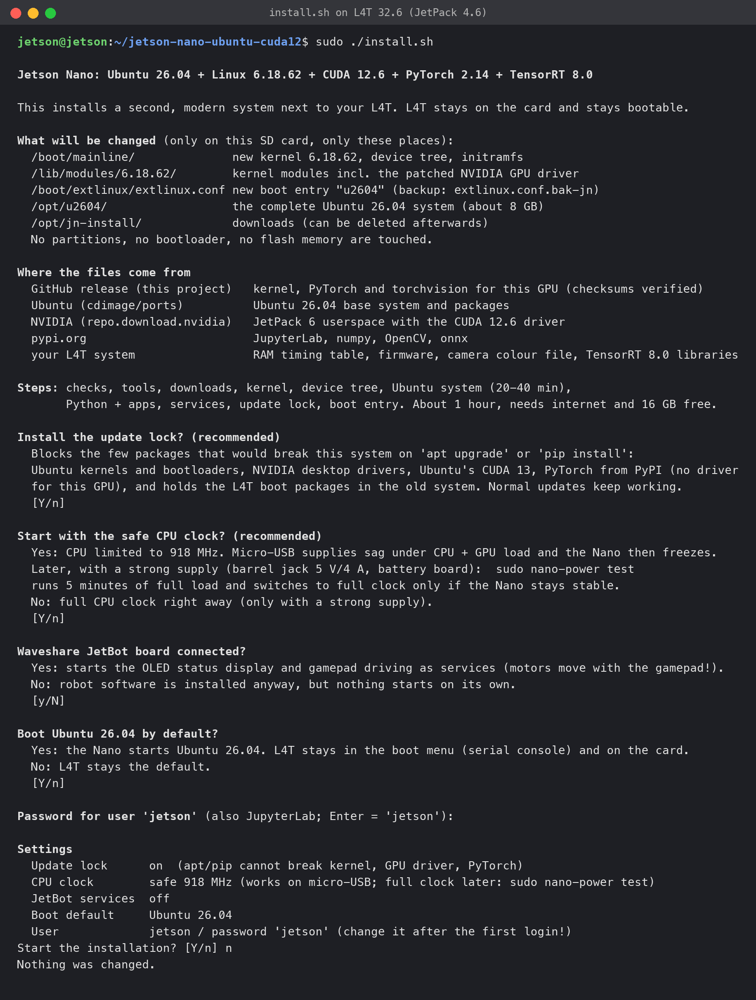
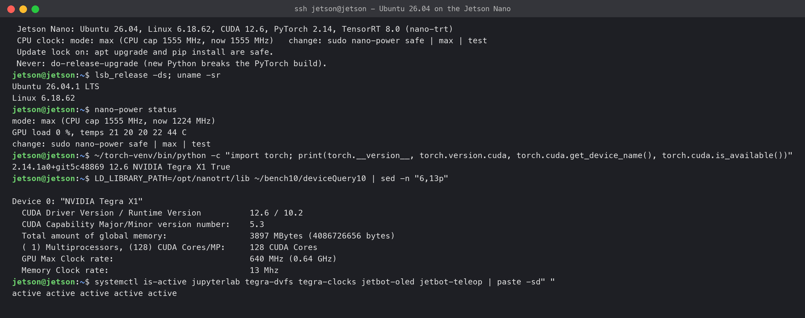
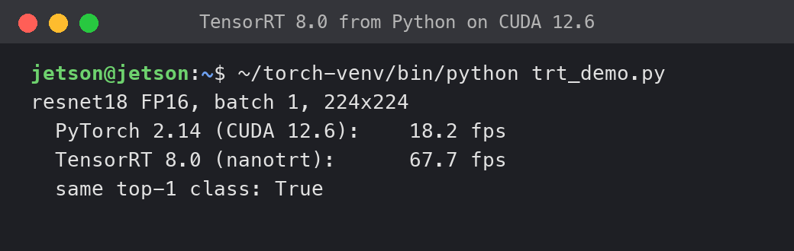
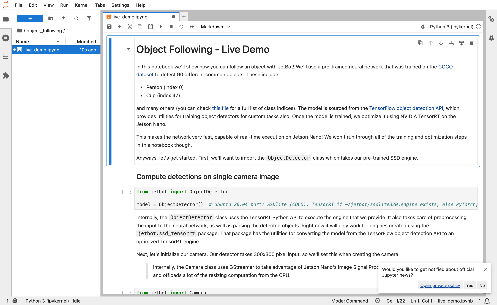

# Ubuntu 26.04 + CUDA 12.6 + PyTorch 2.14 + TensorRT 8 on the Jetson Nano (mainline Linux 6.18)

> **Status: experimental, tested on one board.** `install.sh` ran end-to-end without manual steps on a freshly flashed NVIDIA JetPack 4.6.1 card (16 minutes), and the ready-made image below was tested by flashing and booting it. Use a spare SD card.

NVIDIA stopped supporting the original Jetson Nano 4 GB (Tegra X1 / T210, Maxwell GM20B GPU, sm_53) at Ubuntu 18.04 / CUDA 10.2. This project boots the board with **Ubuntu 26.04 on a mainline Linux 6.18 kernel** and gets the GPU running with the **CUDA 12.6 userspace from JetPack 6**, a self-built **PyTorch 2.14 / torchvision 0.29** with CUDA for sm_53, **TensorRT 8** (8.0 from JetPack 4.6 or 8.2 from JetPack 4.6.1, used from the L4T system on the card, see [docs/tensorrt.md](docs/tensorrt.md)), the **IMX219 CSI camera with colour**, and the **Waveshare JetBot / JetRacer** robot kits. Your original L4T system stays on the card and remains bootable.

The GPU driver is `nvgpu` from the OE4T R36.5 sources, patched to run on mainline T210. See [docs/gpu-cuda.md](docs/gpu-cuda.md).

## Two ways to get it

**A. Ready-made SD card image (easiest).** Flash it, boot, done.

| File | Size | Download |
|---|---|---|
| `jetson-nano-ubuntu-26.04-v0.2.0.img.xz` | 6.7 GB (25.5 GB written, needs a **32 GB or larger** SD card) | [Google Drive](https://drive.google.com/file/d/1KbnhAZUMzqA1VpW7FEuMFEQuR4TZ2x3T/view?usp=sharing) |
| `jetson-nano-ubuntu-26.04-v0.2.0.img.xz.sha256` | SHA-256 `d4bdefab4a9329881b238ea7acf39db422725f173a74f5da1183b5caf161e1a8` | [Google Drive](https://drive.google.com/file/d/1nOEWWLh2C8F0RUmd4KOedo6E30KMWA_2/view?usp=sharing) |

1. Check the download: `sha256sum -c jetson-nano-ubuntu-26.04-v0.2.0.img.xz.sha256` (macOS: `shasum -a 256 -c ...`).
2. Write it to the card with balenaEtcher or Raspberry Pi Imager ("Use custom"); both read `.img.xz` directly.
3. Insert the card, connect ethernet, power on. The first boot takes about 2 minutes and reboots once by itself: it grows the partition to the card, creates new SSH keys and writes this board's RAM timing table (details: [docs/image.md](docs/image.md)).
4. `ssh jetson@jetson.local` (password `jetson`, **change it**: `passwd`). JupyterLab: `http://jetson.local:8888`.

The image is NVIDIA's JetPack 4.6.1 SD card image (L4T 32.7.1, user `jetson`/`jetson`, kept as second system) with this project installed by `install.sh` with the defaults. It contains NVIDIA software under NVIDIA's license terms, see [License](#license). Updates later: `sudo nano-update install` ([docs/updates.md](docs/updates.md)).

**B. Install on your own JetPack 4.6.x card** with `install.sh`, see [Quick start](#quick-start). Takes about 20 minutes and lets you choose the options.

## Screenshots


The installer on L4T 32.6 with all defaults. The answer at the end was "n", so nothing was changed.


Login on Ubuntu 26.04.1 (Linux 6.18.62): nano-power status, PyTorch 2.14 with CUDA 12.6 on "NVIDIA Tegra X1", `deviceQuery` of a CUDA 10.2 program (driver 12.6, runtime 10.2), services active.


resnet18 FP16: 18.2 fps in PyTorch, 67.7 fps with TensorRT (`nanotrt`), same top-1 class.


JupyterLab 4 with the JetBot `object_following` notebook.

## What works

| Area | Result |
|---|---|
| Boot | Ubuntu 26.04.1 (server, no GUI), mainline Linux 6.18.62, about 40 s cold boot to all services |
| GPU | GM20B up to 640 MHz, EMC up to 1600 MHz (by load, see clock scaling) |
| CUDA 12.6 | `deviceQuery` and `bandwidthTest` pass (compute capability 5.3) |
| PyTorch 2.14.1 | CUDA works; matmul 134 GFLOPS FP32 / 119 GFLOPS FP16 |
| Inference | resnet18 224x224 batch 1: 18.2 fps FP16, 15.4 fps FP32 in PyTorch |
| TensorRT 8 | engines built and run on the Nano (`nano-trt`, Python `nanotrt`); resnet18 FP16 67.1 fps with 8.0, 66.9 fps with 8.2.1 (JetPack 4.6.1), 3.7x PyTorch FP16 |
| Road following | 17.3 fps end to end (camera + preprocessing + model) |
| Camera | IMX219 (CSI camera connector), 1640x1232 raw Bayer, colour via CPU debayer (`nanocam`), 30 fps at 224x224 and 640x480 |
| USB, WLAN, Ethernet, I2C | work (USB needs the xusb firmware in the initramfs, handled by the installer) |
| JetBot | motors, OLED, battery voltage, USB gamepad teleoperation, notebooks |
| JetRacer | PCA9685 steering/throttle driver, road following script, Donkeycar 5 helper parts |
| JupyterLab | service on port 8888 |
| Network name | `jetson.local` (avahi), so the changing DHCP address does not matter |
| Object detection | SSDlite320-MobileNetV3 (COCO), 300x300 input: 16.7 fps with TensorRT (17.4 fps with live camera), 12.1 fps in PyTorch FP16 (same at CPU 918 and 1555 MHz: GPU-bound) |
| Clock scaling | `tegra-dvfs`: GPU 77/640 MHz, EMC 204/1600 MHz by load, no performance loss in benchmarks. CPU cap: `sudo nano-power safe\|max\|test` (default safe, 918 MHz; max = 1555 MHz) |

Details and measurements: [docs/benchmarks.md](docs/benchmarks.md). The same board was also measured under NVIDIA's L4T with the same clocks; with TensorRT the speed per clock is the same: [comparison](docs/benchmarks.md#comparison-with-nvidia-l4t).

## What does not work / limitations

- **TensorRT needs the JetPack 4.6.x system on the card.** TensorRT 8, cuDNN 8 and CUDA 10.2 libraries are used from the L4T system at run time (the installer does not copy them). If TensorRT is missing in L4T, the installer skips this step and models run in PyTorch.
- **TensorRT engines are built by hand.** `sudo nano-trt build model.onnx model.engine` takes minutes (resnet18 about 125 s, SSDlite320 about 11 min) and needs root because the GPU watchdog is switched off during the build. Engines have batch 1 and fixed shapes. The TensorRT 8 ONNX parser needs models exported with `nanotrt.export`. See [docs/tensorrt.md](docs/tensorrt.md).
- **No cuDNN benefit in PyTorch.** cuDNN 9.3 contains sm_53 kernels but is slower on this GPU (15.0 vs 18.2 fps), so the wheel is built **without** cuDNN. CUDA 12.6 and PyTorch 2.14 are the newest versions that support sm_53; CUDA 13 and PyTorch 2.15 dropped Maxwell.
- **Simple DVFS only.** `tegra-dvfs` switches GPU and EMC between two levels by load (idle 77 / 204 MHz, busy 640 / 1600 MHz, verified with 435 random switches under load without errors); the CPU scales with `schedutil` up to the cap set by `nano-power`. Power savings were not measured (no power monitor reachable).
- `scp` from some clients hangs. Use another transfer method (see [docs/troubleshooting.md](docs/troubleshooting.md)).
- The Xbox mode of the gamepad needs the `xpad` driver, which is not built. Use the PC mode.
- Camera colours are slightly bluish in mixed light; lens shading correction exists only for 4000 K.
- Only tested on one board (RAM code 0). The installer was tested on an Ubuntu 20.04 card (L4T 32.6.1) and twice on fresh NVIDIA JetPack 4.6.1 cards (L4T 32.7.1).
- Ubuntu 26.04 gets its own DHCP address, usually different from L4T's: use `jetson.local`.

## Hardware requirements

- Jetson Nano Developer Kit 4 GB (B01, SD card version) with JetPack 4.6.x (L4T 32.6/32.7) on the SD card and at least 16 GB free (developed on a 64 GB card with an Ubuntu 20.04 image based on L4T 32.6.1, tested on NVIDIA's JetPack 4.6.1 image); for the ready-made image an SD card of 32 GB or more
- Internet access during installation
- Optional: IMX219 camera (Raspberry Pi Camera v2), Waveshare JetBot or JetRacer kit, USB gamepad

**Power supply warning.** Weak 5 V micro-USB supplies and cables cause brownouts (hangs without any log) under combined CPU and GPU load. With micro-USB the CPU must stay capped at 918 MHz (`nano-power safe`), which is the installer default. With a strong supply, such as a 5 V/4 A barrel jack supply or the Waveshare JetBot battery board, run `sudo nano-power test`: it loads CPU and GPU at the maximum clock (1555 MHz) for 5 minutes and switches to `max` only if that passes. If the Nano hangs during the test, power-cycle it; it boots in the previous mode. See [docs/benchmarks.md](docs/benchmarks.md#power-supply-tests).

## Quick start

1. Start from an **L4T 32.6/32.7 system (JetPack 4.6.x)**: NVIDIA's Jetson Nano Developer Kit SD card image, JetPack 4.6.1 (Ubuntu 18.04), or an Ubuntu 20.04 image based on JetPack 4.6. A blank Ubuntu does not work. Which images, where to get them: [docs/install.md](docs/install.md#prerequisites). Boot it, finish the first-boot setup and connect to the internet.
2. On the Nano:
   ```bash
   git clone https://github.com/L1rs/jetson-nano-ubuntu-cuda12
   cd jetson-nano-ubuntu-cuda12
   sudo ./install.sh
   sudo reboot
   ```
3. After the reboot (about 40 s) log in with `ssh jetson@jetson.local` (the IP address usually differs from L4T's). The default password is `jetson`: **change it** (or set `JETSON_PASS` before installing). JupyterLab is at `http://jetson.local:8888`.

The installer runs about 20 minutes, writes its log to `/var/log/jetson-nano-install.log` and keeps running if the SSH connection drops. If it stops with an error, fix the cause and run it again.

`sudo ./install.sh` shows what it will change and where the files come from, then asks four questions. `sudo ./install.sh --plan` only shows this and changes nothing; `sudo ./install.sh -y` asks nothing. Options (`UPDATE_LOCK`, `POWER`, `ROBOT`, `SET_DEFAULT`, ...) and details: [docs/install.md](docs/install.md).

## Documentation

| File | Content |
|---|---|
| [docs/how-we-got-here.md](docs/how-we-got-here.md) | How the result was reached: analysis of the JetPack 6 userspace, kernel work, dead ends, lessons for other boards |
| [docs/install.md](docs/install.md) | Installer step by step, options, downloads, going back to L4T |
| [docs/architecture.md](docs/architecture.md) | Boot chain, kernel, modules, services |
| [docs/gpu-cuda.md](docs/gpu-cuda.md) | What the kernel and nvgpu patches do |
| [docs/pytorch.md](docs/pytorch.md) | How the wheels were built, cuDNN finding |
| [docs/tensorrt.md](docs/tensorrt.md) | TensorRT 8 from the L4T libraries: `nano-trt`, Python `nanotrt`, JetBot detector |
| [docs/camera.md](docs/camera.md) | IMX219 and the `nanocam` module |
| [docs/robots.md](docs/robots.md) | JetBot and JetRacer |
| [docs/benchmarks.md](docs/benchmarks.md) | All measurements |
| [docs/image.md](docs/image.md) | Ready-made SD card image: first boot, how the image is made |
| [docs/updates.md](docs/updates.md) | Update check and `sudo nano-update install`; how to make a release |
| [docs/troubleshooting.md](docs/troubleshooting.md) | Known problems |
| [THIRD_PARTY.md](THIRD_PARTY.md) | Third-party components and licenses |
| [CHANGELOG.md](CHANGELOG.md) | Versions |

## Repository layout

```
install.sh        entry point (run on the Nano under L4T)
update.sh         brings an installed system to the state of a release (run by nano-update)
rootfs/           build-rootfs.sh (Ubuntu 26.04 root, services, initramfs), init, nano-power, nano-update, tegra-dvfs.py, package lists
image/            ready-made SD card image: clean-for-image.sh, firstboot.sh, read/shrink/flash scripts
kernel/           build scripts, kernel config (config-6.18-t210), device tree include for the IMX219, EMC table converter, patches/
pytorch/          build scripts for torch/torchvision and the CUDA samples (run in a build container)
camera/           nanocam.py (IMX219 -> RGB/BGR numpy images)
jetbot/           hardware driver, OLED service, gamepad teleop, compatibility package, notebooks
jetracer/         PCA9685 car driver, camera shim, road following, notebook porting, Donkeycar parts
tensorrt/         build.sh (TensorRT setup), nano-trt, nanotrt.py, trt_shim.cpp, DLA stubs
tools/            bench.py, psu-test.sh, emc-stress.sh, l4t-compare.sh, bench_cmp.py, gpuclk.py
dist/             release assets (not in git; attached to each GitHub release)
```

Some scripts have German code comments.

## License

- Own code and documentation: MIT ([LICENSE](LICENSE)).
- `kernel/patches/`: GPL-2.0 (patches to Linux and the OE4T nvidia-oot/nvgpu sources). The kernel release asset is GPL-2.0.
- JetBot notebooks in `jetbot/notebooks/`: MIT, (c) NVIDIA ([LICENSE-jetbot.md](jetbot/notebooks/LICENSE-jetbot.md)).
- `install.sh` does not redistribute NVIDIA software: it downloads the JetPack 6 userspace and CUDA runtime from NVIDIA and uses the L4T files already on your card. See [THIRD_PARTY.md](THIRD_PARTY.md).
- The **ready-made image** contains NVIDIA software: NVIDIA's JetPack 4.6.1 SD card image (L4T, CUDA 10.2, cuDNN, TensorRT) and the JetPack 6 userspace with the CUDA 12.6 runtime, unchanged, under NVIDIA's license terms (the image includes NVIDIA's license files, and L4T shows its license at `/usr/share/doc/nvidia-tegra/`). It is an unofficial community image, not provided or supported by NVIDIA. If you prefer not to download NVIDIA software from a third party, use `install.sh` on NVIDIA's own image.

## Credits

- [OE4T](https://github.com/OE4T) `nvidia-kernel-oot` / `linux-nvgpu` (branch `wip-r36.5-6.18`), based on NVIDIA's R36.5 sources
- Mainline Linux (Tegra210 support, tegra210-emc, host1x, tegra-video)
- NVIDIA JetPack (L4T r36.4 userspace, CUDA 12.6, cuDNN)
- PyTorch and torchvision
- Waveshare and NVIDIA JetBot / JetRacer projects
