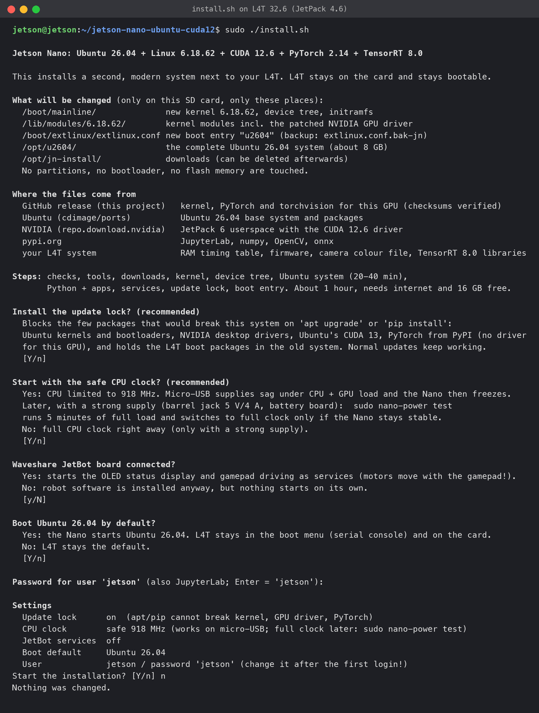

# Installation

> Experimental, one board. `install.sh` ran end-to-end without manual steps on a fresh NVIDIA JetPack 4.6.1 card (16 minutes). Use a spare SD card. No time to install? Use the ready-made image ([README](../README.md#two-ways-to-get-it), [image.md](image.md)).

## Prerequisites

The installer does not start from a blank Ubuntu. It needs a working **NVIDIA L4T system from JetPack 4.6.x (L4T 32.6 or 32.7)** on the SD card, because it takes three things from it that a plain Ubuntu does not have: NVIDIA's boot chain on the card (cboot reads `/boot/extlinux/extlinux.conf`), the RAM timing table that this bootloader trained for your board (read from the running device tree), and firmware/TensorRT files. L4T itself stays on the card and remains bootable.

### Which image to start from

| Starting image | L4T | Status |
|---|---|---|
| NVIDIA "Jetson Nano Developer Kit SD Card Image", JetPack 4.6.1 (Ubuntu 18.04) | 32.7.1 | **Recommended, tested end-to-end** (twice, fresh card, `sudo ./install.sh -y`). Contains TensorRT 8.2.1, which works the same as 8.0. |
| NVIDIA SD card image JetPack 4.6 (Ubuntu 18.04) | 32.6.1 | Same L4T release as the tested board; not tested end-to-end. |
| [Qengineering Ubuntu 20.04 image](https://github.com/Qengineering/Jetson-Nano-Ubuntu-20-image) (based on JetPack 4.6) | 32.6.1 | The board this project was developed on; every step was verified by hand here. The image download (cloud storage link) is often unreliable, so it is not the recommended starting point. |
| JetPack 4.5 or older | 32.5 and older | Not supported (older bootloader and libraries); the installer stops. |
| Plain Ubuntu, other distributions, Jetson Nano 2 GB | - | Not supported. |

Where to get the NVIDIA image: [Jetson Nano Developer Kit - Getting Started](https://developer.nvidia.com/embedded/learn/get-started-jetson-nano-devkit) or the [JetPack archive](https://developer.nvidia.com/embedded/jetpack-archive) (JetPack 4.6.1, "SD Card Image" for the Jetson Nano Developer Kit). NVIDIA moves these links from time to time; the file is called `jetson-nano-jp461-sd-card-image.zip`. Flash it with balenaEtcher or Raspberry Pi Imager ("use custom image"), boot and finish the first-boot setup (user, network). Without a monitor the setup runs on the serial console of the micro-USB port (`/dev/ttyACM0` on Linux, `/dev/cu.usbmodem*` on macOS, 115200 baud), not on the UART header. The fresh image has no `curl`; `git` and `wget` are there, and the installer installs `curl` itself.

The installer checks for L4T 32.6 or newer (`/etc/nv_tegra_release`) and stops otherwise.

### Also needed

- Jetson Nano Developer Kit **4 GB** (B01 or A02), SD card with at least **16 GB free** on `/`. The new system uses about 2.7 GB for the root file system plus the venv with PyTorch, a 4 GB swap file and downloads (the release assets are about 210 MB).
- Internet access on the Nano.
- A power supply that survives load, see the warning in the [README](../README.md). On micro-USB keep the default "safe CPU clock".
- Optional but useful: a serial console (UART header, 115200 8N1). Without it you cannot pick a boot entry at the bootloader menu (see below).

## Run

```bash
git clone https://github.com/L1rs/jetson-nano-ubuntu-cuda12
cd jetson-nano-ubuntu-cuda12
sudo ./install.sh
sudo reboot
```

| Command | What it does |
|---|---|
| `sudo ./install.sh` | Runs the checks, shows an overview of the changes and the file sources, asks four questions with explanations and the password, shows a settings summary and asks `Start the installation? [Y/n]`. |
| `sudo ./install.sh --plan` | Only shows the overview and the settings. Changes nothing and runs anywhere. |
| `sudo ./install.sh -y` | No questions. Uses the defaults or the environment variables below. |

While it runs:
- The installer checks the clock, the internet connection and the release files before it asks anything.
- The complete log goes to `/var/log/jetson-nano-install.log`. If the SSH connection drops, the installation keeps running; follow it with `tail -f /var/log/jetson-nano-install.log`.
- L4T runs in the 5 W power mode while installing (MAXN can freeze the Nano on weak supplies and lose files) and gets its previous mode back at the end.
- If it stops with `ERROR in step N`, fix the cause and run it again. Finished parts are skipped or redone; the Python environment is always rebuilt.



The screenshot shows the dialog on a real L4T 32.6 system with all defaults. The answer at the end was "n", so nothing was changed.

Duration: the Ubuntu root file system step takes about 20-40 minutes (it downloads about 1 GB); the whole run depends mostly on your network and SD card speed. First boot into Ubuntu 26.04 takes about 40 s.

## Settings

The installer asks for these. You can also set them as environment variables, for example `sudo UPDATE_LOCK=0 ./install.sh -y`.

| Variable | Default | Meaning |
|---|---|---|
| `UPDATE_LOCK` | `1` | `1`: apt pins against Ubuntu kernels and bootloaders, NVIDIA desktop drivers and Ubuntu's CUDA 13; pip constraints for torch and torchvision; `apt-mark hold` of `nvidia-l4t-*` in L4T. Normal updates keep working. `0`: no lock at all; you must avoid kernel, NVIDIA, CUDA and torch updates yourself. |
| `POWER` | `safe` | `safe`: CPU capped at 918 MHz, stable on micro-USB supplies. `max`: full clock (1555 MHz) from the first boot, needs a strong supply. Change it later with `nano-power`, see below. |
| `ROBOT` | `none` | `jetbot` starts the OLED and gamepad services for the Waveshare JetBot board (the motors move with the gamepad). `none`: the robot software is installed, but nothing starts on its own. |
| `SET_DEFAULT` | `1` | `1`: boot Ubuntu 26.04 by default; `0`: keep L4T as default. |
| `JETSON_USER` / `JETSON_PASS` | `jetson` / `jetson` | User of the new system; the password is also the JupyterLab password. The installer asks for the password (hidden, Enter keeps `jetson`). **Change it.** |
| `RELEASE_URL` | `https://github.com/L1rs/jetson-nano-ubuntu-cuda12/releases/download/v<VERSION>` | Where the release assets are downloaded from. Point it at your own mirror or fork. |

`CPU_KHZ` is no longer an `install.sh` option; `POWER` replaces it. (`rootfs/build-rootfs.sh` still takes `CPU_KHZ` internally.)

Example: `sudo POWER=max ROBOT=jetbot JETSON_PASS=secret ./install.sh -y`.

## What the installer does

The checks (root, Jetson Nano, L4T R32, 16 GB free, `/boot/extlinux/extlinux.conf` exists) run before the questions. Then ten numbered steps:

1. Checks passed.
2. Tools: installs `device-tree-compiler`, `curl`, `python3` with apt.
3. Downloads the release assets to `/opt/jn-install` and verifies `SHA256SUMS`: the kernel archive `linux-6.18.62-t210-jetson-nano.tar.gz`, the torch wheel and the torchvision wheel.
4. Kernel: backs up `extlinux.conf` (`extlinux.conf.bak-jn`), unpacks the kernel archive into `/` (`/boot/mainline/Image`, device tree, modules in `/lib/modules/6.18.62`, the out-of-tree modules `nvgpu`, `nvmap`, `host1x-fence`, `mc-utils` in `.../extra`) and runs `depmod`.
5. Device tree: converts the **EMC memory timing table trained by the L4T bootloader on this board** (read from the live device tree, RAM code 0-3) with `kernel/emc-table.py`, and patches `tegra210-p3450-0000.dtb`: GPU compatible `nvidia,tegra210-gm20b`, removes the GPU's `iommus`, inserts the EMC table, enables I2C1 (header pins 3/5).
6. Ubuntu system: runs `rootfs/build-rootfs.sh`: Ubuntu base 26.04.1 into `/opt/u2604`, packages, user, network (copies your existing WLAN profiles, DHCP on `eth0`), JetPack 6 userspace libraries, initramfs.
7. Python environment: venv `~/torch-venv` with the two wheels, JupyterLab, ipywidgets, anywidget, smbus2, traitlets, `onnx`, `numpy==2.5.*` and `opencv-python-headless==5.0.*`; `nanocam`; JetBot/JetRacer files. Includes the TensorRT setup: `tensorrt/build.sh` sets up TensorRT 8 (8.0 or 8.2.1) in `/opt/nanotrt` from the libraries of your L4T install (symlinks, DLA stubs, `trt_shim`, `nano-trt`, `nanotrt.py`). If L4T has no TensorRT, that part is skipped. See [tensorrt.md](tensorrt.md).
8. Services: JupyterLab, `tegra-dvfs` (with `tegra-clocks` and `/etc/default/nano-power`), the JetBot services (only with `ROBOT=jetbot`), 4 GB swap file, the login message `/etc/update-motd.d/99-jetson-nano` (says whether the update lock is on), `nano-power` in `/usr/local/sbin`.
9. Update lock (only with `UPDATE_LOCK=1`).
10. Boot entry: extlinux entry `u2604`, and `DEFAULT u2604` if `SET_DEFAULT=1`.

### Downloads

| What | From |
|---|---|
| Kernel archive, torch and torchvision wheels, `SHA256SUMS` | the GitHub release of this repository (`RELEASE_URL`) |
| `nvidia-l4t-core`, `nvidia-l4t-cuda`, `nvidia-l4t-3d-core` debs (r36.4, only `libnvidia-ptxjitcompiler` from the last) | `repo.download.nvidia.com/jetson/t234/pool/main/n/...` |
| CUDA 12.6 runtime libraries (`cuda-cudart`, cuBLAS, cuFFT, cuRAND, cuSOLVER, cuSPARSE, NVRTC, cuFile) | NVIDIA Jetson apt repository `jetson/common r36.4`; the repository entry is removed again afterwards so `apt upgrade` never pulls L4T kernel packages |
| Ubuntu base 26.04.1 arm64 | `cdimage.ubuntu.com` |
| Ubuntu packages, Python packages | Ubuntu archive, PyPI |

The NVIDIA files are downloaded onto your device and are not part of this repository. See [THIRD_PARTY.md](../THIRD_PARTY.md).

## CPU clock: `nano-power`

```bash
sudo nano-power status     # mode and clocks
sudo nano-power safe       # CPU cap 918 MHz (default)
sudo nano-power max        # CPU cap 1555 MHz (highest clock the kernel offers)
sudo nano-power test       # load test at max, saves max only if it passes
```

`safe` is stable on weak micro-USB supplies. `max` reads the highest clock from the kernel (`cpuinfo_max_freq`: 1555 MHz on the tested board; the kernel caps higher requests, earlier docs said 1912 MHz). It needs a strong 5 V supply, for example a barrel jack supply with 5 V/4 A or the Waveshare JetBot battery board. `test` runs 5 minutes (environment variable `DUR`, in seconds) of full CPU load (3 cores) and GPU FP16 matmul load at max. It saves `max` only if the GPU load runs the full time without a CUDA error and the GPU process stops normally. Otherwise it prints `FAILED`, keeps the previous mode and recommends a reboot. If the Nano hangs, power-cycle it: it boots in the previous mode, because the setting is written only after the test. On the Waveshare JetBot battery board the test passed (5 minutes at max); on a micro-USB supply a short test failed with GPU firmware errors, which the test detected. Log: `/var/log/nano-power-test.log`.

The setting is stored in `/etc/default/nano-power` (`CPU_KHZ=...`, in kHz) and read by `tegra-clocks.service`. The login message shows the current mode.

## After the installation

- Reboot. SSH: `ssh jetson@jetson.local`. JupyterLab: `http://jetson.local:8888` (password = user password). Ubuntu 26.04 may get a different IP address from your router than L4T had; `jetson.local` works on macOS, Linux and Windows 10+.
- Check CUDA: `~/torch-venv/bin/python -c "import torch; print(torch.cuda.is_available())"` (`nvidia-smi` does not exist on Tegra).
- Check TensorRT: `nano-trt` prints its usage. For the JetBot object detector run `~/jetbot/build_detector.sh` once (about 10 min). See [tensorrt.md](tensorrt.md).
- The CPU runs in safe mode (918 MHz) unless you chose `POWER=max`. With a strong supply, run `sudo nano-power test`.
- The old L4T system is mounted at `/media/l4t` inside Ubuntu 26.04. Do not edit its boot configuration from there unless you know what you are doing.

## Going back to L4T

Boot entry selection works only through `extlinux.conf`. Either restore the backup `/boot/extlinux/extlinux.conf.bak-jn` (from L4T, or from `/media/l4t/boot/extlinux/` in Ubuntu 26.04), or put the SD card into another computer and set `DEFAULT primary` in `/boot/extlinux/extlinux.conf` of the first partition. The L4T system itself is not modified (apart from `/opt/u2604`, `/opt/jn-install`, `/boot/mainline` and the extlinux entry).

## Troubleshooting

- **No serial console:** the bootloader menu can only be answered over serial. Without it the entry used is the `DEFAULT` line in `extlinux.conf`. Answer the boot question with `n` (or set `SET_DEFAULT=0`) if you prefer to keep L4T as default and switch by editing the file; to try Ubuntu 26.04 without a serial console, change `DEFAULT` to `u2604`.
- **USB does not work:** `tegra-xusb` is built into the kernel and needs `nvidia/tegra210/xusb.bin` before the root switch. The installer puts it into the initramfs from L4T's `/lib/firmware`. If you rebuild the initramfs, include it.
- **Installer stops with "no trained EMC table found":** the live L4T device tree must contain a trained table for your RAM code.
- **Installer stops with "start from L4T 32.7":** other L4T versions were not tried.
- More: [troubleshooting.md](troubleshooting.md).
