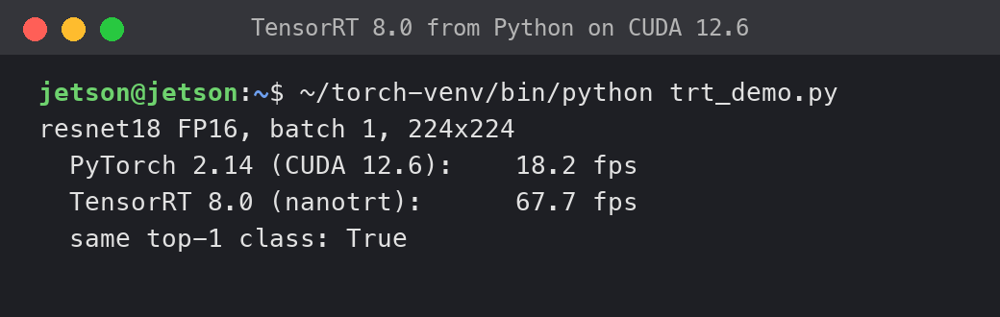

# TensorRT 8

TensorRT 8 runs on the Nano under Ubuntu 26.04. The libraries come from the JetPack 4.6.x (L4T) system on the same card: TensorRT 8.0.1 with JetPack 4.6, 8.2.1 with JetPack 4.6.1 (tested: same setup, resnet18 FP16 66.9 fps, 0.2 % deviation from PyTorch). The installer downloads nothing from NVIDIA for this. The text below was written with 8.0.1; everything applies to 8.2.1 as well.

## How it works

TensorRT 10 (JetPack 6) has no sm_53 kernels, so it cannot be used. The old TensorRT 8.0 of JetPack 4.6 does have them, but it needs CUDA 10.2 and the old kernel interface. The pieces that make it work:

- The CUDA 12.6 driver (`libcuda` r36) also runs applications built for CUDA 10.2. This was checked with a CUDA 10.2 runtime plus cuBLAS 10 test and with TensorRT.
- cuBLAS 10, cuDNN 8.2 and TensorRT 8.0 contain sm_53 kernels.
- Two libraries of the old stack talk to the old kernel ABI: `libnvmedia` and `libnvdla_compiler`. They belong to the DLA accelerator, which the Nano does not have. They are replaced by small stubs (`nvmedia-stub.c`, `nvdla-stub.c`) that return 0. `NvMediaDlaGetNumEngines` reports 0 engines.
- `tensorrt/build.sh` creates `/opt/nanotrt/lib` with symlinks to the L4T libraries (`/media/l4t/...`), compiles the stubs and `trt_shim` with the L4T toolchain (g++ 7, TensorRT and CUDA 10.2 headers) in a chroot, and installs `/usr/local/bin/nano-trt` and `/opt/nanotrt/nanotrt.py`. `trt_shim.cpp` is a C interface of about 40 lines that Python calls through `ctypes`.

`install.sh` runs `build.sh` under L4T. You can also run it inside Ubuntu 26.04 with L4T mounted at `/media/l4t`. If TensorRT is missing in L4T, the step is skipped and the installer continues. The installer ends with a hint for `build_detector.sh`.



resnet18 FP16 on the Nano: PyTorch 18.2 fps, TensorRT via `nanotrt` 67.7 fps, same top-1 class.

## Build an engine

```bash
sudo nano-trt build model.onnx model.engine            # default: --fp16
sudo nano-trt build model.onnx model.engine --fp16 --workspace=256
nano-trt bench model.engine                            # trtexec --loadEngine, 10 s (DUR=seconds)
nano-trt trtexec ...                                   # any trtexec options
```

`build` needs root. It switches off the nvgpu channel watchdog (`/sys/kernel/debug/gpu.0/timeouts_enabled`) during the build and turns it on again afterwards. See [Troubleshooting](#troubleshooting) for the reason.

Build times on the Nano: resnet18 FP16 about 125 s, resnet50 FP16 about 285 s, SSDlite320 backbone and head about 670 s (11 min).

## Python

`nanotrt` is on the venv path (`/opt/nanotrt/nanotrt.py`, via a `.pth` file).

```python
import torch, torchvision, nanotrt

model = torchvision.models.resnet18(weights='DEFAULT').eval()
x = torch.randn(1, 3, 224, 224)
nanotrt.export(model, x, 'resnet18.onnx')        # ONNX in the form TensorRT 8.0 accepts
# then, in a shell: sudo nano-trt build resnet18.onnx resnet18.engine

m = nanotrt.TRTModule('resnet18.engine')
y = m(x)                                         # input is moved to the GPU and cast to the engine dtype; returns a CUDA tensor
```

- `nanotrt.export` writes opset 11 and IR version 6, and removes Identity nodes that the current PyTorch exporter puts in front of shared Conv weights. Without this, the TensorRT 8.0 parser fails in `importConv`.
- `TRTModule` runs in the same CUDA context as PyTorch: the CUDA 10.2 runtime sits next to PyTorch's 12.6 runtime on one driver. The libraries are loaded with `RTLD_DEEPBIND`. cuBLAS and cuDNN are preloaded because TensorRT opens them by name.
- Engines have batch 1 and fixed shapes. A call with another input shape raises `ValueError`. Several outputs are returned as a tuple.
- The pip package `onnx` is installed by `install.sh`.

## JetBot object detector

`jetbot.ObjectDetector` uses `~/jetbot/ssdlite320.engine` if it exists. Otherwise it runs in PyTorch FP16. Build the engine once:

```bash
~/jetbot/build_detector.sh      # about 10 min, asks for the sudo password
```

Restart running notebooks afterwards. Backbone and head run in TensorRT or PyTorch. The postprocessing was rewritten: instead of torchvision's per-class loop over 90 classes, it takes the top 200 over all anchors and classes and runs one `batched_nms` (score threshold, `nms_thresh` of the model, 20 detections). At 918 MHz CPU this loop was the main bottleneck.

## Numbers

All on one Nano, GPU 640 MHz, 2026-11-09. Details and method: [benchmarks.md](benchmarks.md).

| Model | TensorRT 8.0 FP16 | PyTorch 2.14 FP16 | Factor |
|---|---|---|---|
| resnet18, 224x224 | 67.1 fps (67.6 fps from Python via `TRTModule`) | 18.2 fps | 3.7x |
| resnet50, 224x224 | 24.8 fps | 8.7 fps | 2.8x |

Accuracy: for resnet18 FP16 the maximum absolute difference to the FP32 PyTorch output is 0.014 (logits up to 5.9), with the same argmax.

Object detector (SSDlite320, 300x300 input, CPU 918 MHz = `nano-power safe`):

| Path | fps |
|---|---|
| old PyTorch path (per-class postprocessing) | 5.4 |
| new PyTorch path | 12.1 |
| TensorRT | 16.7 (17.4 with the live camera) |

On a test image, TensorRT and PyTorch find the same dog (label 18, confidence 0.82 against 0.83, identical box).

## Limitations

- Needs TensorRT 8.0, cuDNN 8.2 and CUDA 10.2 libraries in the L4T install on the same card.
- Batch 1, fixed shapes.
- Models must go through the TensorRT 8.0 ONNX parser (opset 11). Use `nanotrt.export` for PyTorch models.
- Engines are built on the Nano with `sudo nano-trt build` and are tied to this TensorRT version and GPU.
- No DLA (the Nano has none).

## Troubleshooting

**The Nano hangs during an engine build.** TensorRT times several kernel candidates, and some run longer than the 7 s nvgpu watchdog. The watchdog recovery (channel teardown) in this nvgpu port leaves the GPU in a bad state (PRI timeouts, PMU DMEM errors) and then hangs the whole Nano. This caused the first freezes. `nano-trt build` switches the watchdog off for the build. Do not run `trtexec` for builds directly; use `nano-trt`. Power-cycle the Nano after a hang.

**`importConv` error or failed ONNX parse.** The ONNX file was written by a newer exporter. Export with `nanotrt.export`, which uses opset 11, IR version 6 and removes the Identity nodes in front of shared Conv weights.

**`Unable to load library: libcublas.so.10`.** TensorRT opens cuBLAS and cuDNN by name. In Python, import `nanotrt` first (it preloads them). For `trtexec` run by hand, set `LD_LIBRARY_PATH=/opt/nanotrt/lib`, or use `nano-trt trtexec`, which sets it.

**TensorRT is missing after the install.** The installer skipped it because L4T has no TensorRT. Check `ls /media/l4t/usr/lib/aarch64-linux-gnu | grep nvinfer`. Then run `sudo sh tensorrt/build.sh` inside Ubuntu 26.04.

**GPU errors after a failed test at max clocks.** See [troubleshooting.md](troubleshooting.md).

## Legal note

The TensorRT, cuDNN and CUDA 10.2 libraries are NVIDIA's and are used from your own L4T install at run time. The repository and the release assets contain none of them. The stubs and `trt_shim.cpp` are own code (MIT). See [THIRD_PARTY.md](../THIRD_PARTY.md).
